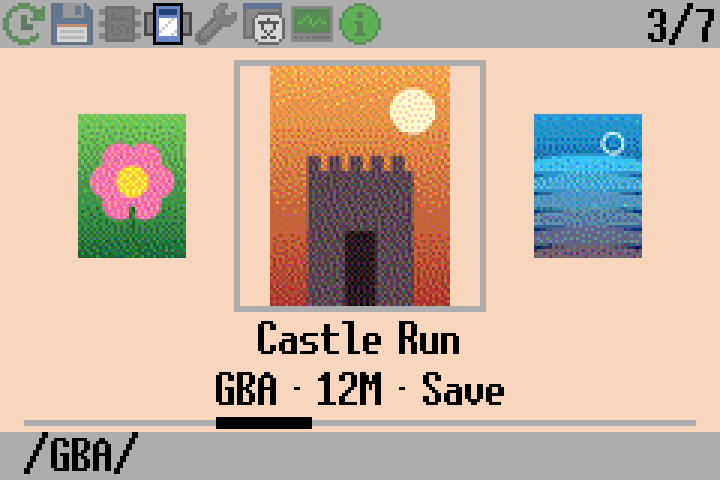
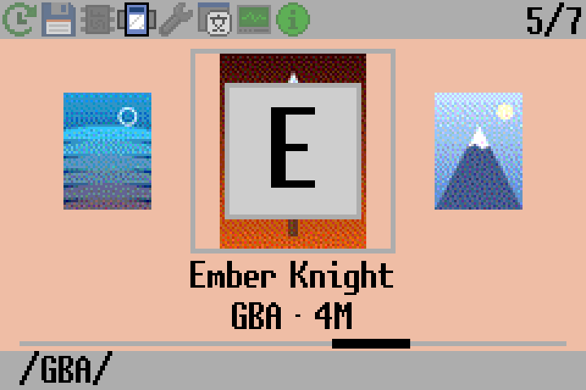
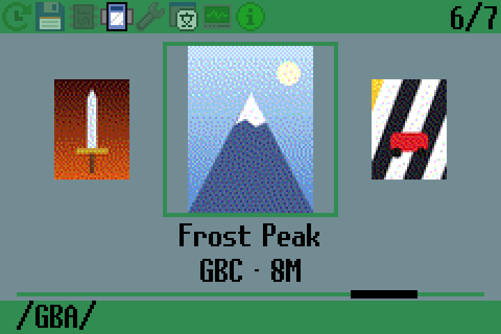
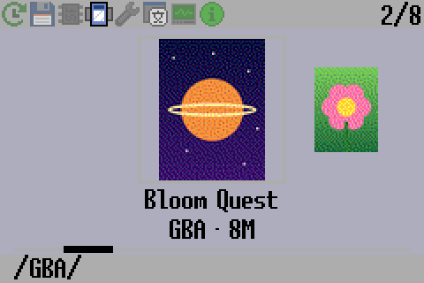
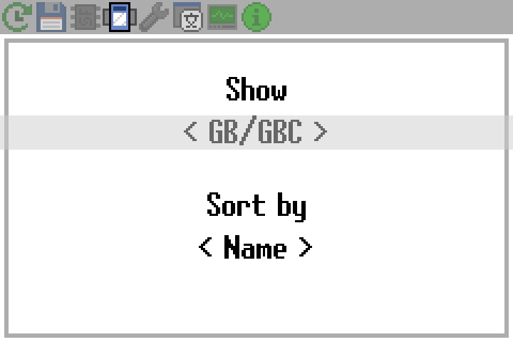
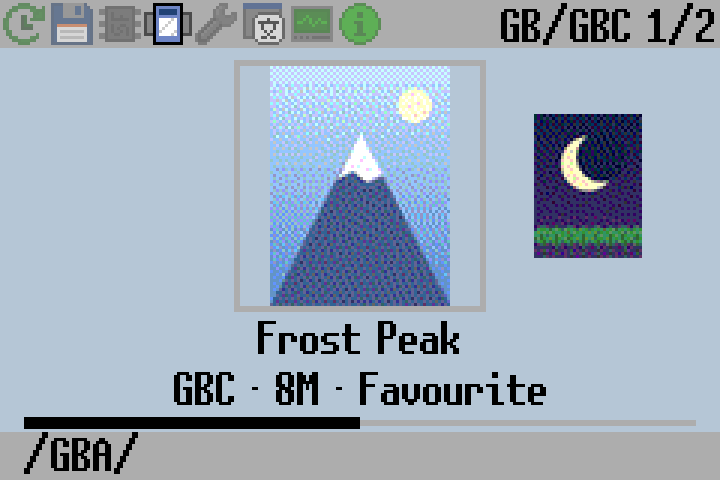

SuperFW
=======

An alternative firmware for Supercard GBA flash carts (and derivatives/clones)

This project aims to provide a more modern and better firmware for Supercard
flash carts (which are still widely used and very cheaply available). The goal
is to add many features only present in more expensive or sophisticated flash
carts. Unfortunately we are limited to the actual hardware so certain features
are impossible or very complex to implement.

Find the website and documentation at https://superfw.davidgf.net/

Installation
------------

Check https://superfw.davidgf.net/docs/install/flash/ for more details.

The firmware can be chain-loaded using another firmware (ie. the default
SuperCard firmware or SCFW) and loaded as a regular game. It can also be
installed on the internal flash device. Installing it enables some nice
features such as SDHC and exFAT compatibility.

To install the firmware you can simply load it first, and then use SuperFW
to flash itself on the flash. You will need to enable flashing in the Info
tab and then pick the .fw file and flash it. It is strongly recommended to
reboot your GBA after flashing.

Flashing is also possible using an NDS. This is particularly useful if you
_brick_ your Supercard (ie. interrupting flashing, low battery conditions
and similar situations could cause a bad flash). You will need an NDS device
and a Slot-1 cart as well. Download the .nds ROM for your Slot-1 cart at
https://github.com/davidgfnet/superfw-nds-flasher-tool/releases/ and launch
it with your Supercard on your Slot-2. You should be able to flash (as well
as backup) your flash.

GB/GBC Emulation
----------------

GameBoy and GameBoy Color ROMs can be played by using the built-in Goombacolor
emulator binary (the Lite build doesn't ship any emulator though). Picking any
.gb/.gbc file will load the emulator and the ROM and start its execution.

Other devices can also be played as long as the right emulator is installed in
the SD card (and supported by SuperFW).

Check https://superfw.davidgf.net/docs/usermanual/emulators/ for details.

Carousel (cover art) tab
------------------------

The carousel tab (the icon after the SD/NOR browsers) shows the games in the
folder currently open in the SD browser, and in all its subfolders, as a row
of box art covers sorted by name:

 - Left/Right: previous/next game (covers slide and zoom in/out).
 - Up/Down: jump to the previous/next letter (shown big for a moment). When
   sorted by system they jump between systems, when sorted by recently played
   they move 5 games.
 - A: open the game (same load options as the browser). If the game was
   written to the flash (SuperChis) from this SD file, it starts from flash.
 - Select: file menu, the same as in the SD browser (delete, hide, write to
   flash). For games already in flash it offers "Remove from flash" (same as
   the flash tab) and "Load from SD card" instead, and shows the flash usage.
   "Add to favourites" / "Remove from favourites" is there too.
 - Start: the view, which games are shown and in which order (see below).
 - L/R switch tabs.

| Letter jump (Up/Down) | Another color theme |
|---|---|
|  |  |

The games and covers in these pictures are made up (drawn by
`docs/images/make-examples.py`, so no real box art is in the repository); the
screens are rendered by `tools/carousel-preview.py` with the firmware's layout
and assets.

### View: which games, in which order (Start)

Start opens the view. Up/Down picks the row, Left/Right changes it, A or Start
closes it. It is remembered (in `ui-settings.txt`).

 - Show: all games, the favourites, or one system. The systems come from the
   file types, not the folder names, and only the ones there are games for
   are offered: GBA (`.gba`), GB/GBC (`.gb`, `.gbc`: one emulator), NES
   (`.nes`), SMS (`.sms`), GG (`.gg`), SG (`.sg`), SV (`.sv`), NGC (`.ngc`)
   and PCE (`.pce`).
 - Sort by: name, system (the games grouped by emulator; Up/Down then jump
   from one system to the next) or recently played (Up/Down move 5 games).

When not all games are shown, the top bar shows the view next to the position
(ie. "GB/GBC 1/2"), if it fits.

| The view (Start) | Only the GB/GBC games |
|---|---|
|  |  |

The carousel lists the folder open in the SD browser and its subfolders. To
have every game on the card in it (and filter them with Show), open the root
of the card (`/`) in the SD browser before switching to the carousel.

### Favourites

Select > "Add to favourites" (or "Remove from favourites") in the carousel.
Favourites show "Favourite" in the info line and have their own view (Show >
Favourites). They are kept in `/.superfw/favorites.txt`, one full path per
line, so they can also be edited on a PC. A game that is renamed or moved is
no longer a favourite (the recent list works the same way).

The background takes the color of the selected cover. Below the title it shows
the system, the size, whether there is a save file, whether it is the last
played game and whether it is in flash, plus a bar with the position in the
list. The bottom bar shows the game's folder. Set UI settings, "Start tab" to
start SuperFW on the carousel (it opens at the last played game).

The game list is kept in `/.superfw/carousel.cache`, so it shows up at once.
It is then checked against the card in the background, and rescanned if games
were added, removed or renamed.

Covers are read from `/.superfw/covers/<rom file name>.cov` (for example
`Metroid Fusion (USA).gba.cov`) or, for GBA games, from
`/.superfw/covers/<game code>.cov` (for example `AMTE.cov`), which keeps
working after renaming the ROM. Games without a cover show a plain card. To
create the covers, run the PC tool with the SD card inserted (needs Python 3
and Pillow, `pip install pillow`):

    python tools/make-covers.py E:\

It scans the whole card and identifies each ROM exactly by its checksum (or
GBA game code) using the No-Intro game lists, then downloads the box art for
that official name from the libretro thumbnails collection. ROMs it cannot
identify (hacks, homebrew, bad dumps) are matched by file name instead. Use
`--images <folder>` to provide your own images (named like the ROM, ie.
`Metroid Fusion (USA).png`), `--dry-run` to see the matches first,
`--force` to regenerate covers and `--no-checksum` to skip reading the ROMs.

`--gui` opens a window instead: pick the SD card, then it shows the progress,
the box art picked for every game and a preview of each cover as the cart
<<<<<<< HEAD
shows it. The tool can also be packaged as a program that needs no Python
(PyInstaller, works on Windows, macOS and Linux); started without arguments
it opens the window (the Windows .exe on the SD card root picks that card):
=======
shows it.

It also adds the cheats of the GBA games on the card: it downloads the
SuperFW cheat database (https://github.com/davidgfnet/superfw-cheats, kept in
its cache for when there is no internet) and copies the files for those games
to `/.superfw/cheats/` (named `<game code>-<version>.cht`, as SuperFW looks for
them). Cheat files already on the card are never overwritten, so edited ones
are kept; `--no-cheats` skips this. With `--firmware chis` (or `sd`, `lite`)
it also copies the latest SuperFW firmware for that board to the card root,
ready to be flashed from the SD browser. The window has both options too.

Ready to use programs (no Python needed, always the latest version, built by
GitHub Actions, checksums in
[SHA256SUMS.txt](https://github.com/Crivons1/superfw/releases/download/make-covers-latest/SHA256SUMS.txt)):

 - Windows: [make-covers.exe](https://github.com/Crivons1/superfw/releases/download/make-covers-latest/make-covers.exe)
 - macOS: [make-covers-macos.zip](https://github.com/Crivons1/superfw/releases/download/make-covers-latest/make-covers-macos.zip)
   (the first time, right-click the app and choose Open)
 - Linux: [make-covers-linux](https://github.com/Crivons1/superfw/releases/download/make-covers-latest/make-covers-linux)
   (`chmod +x` it first)

Double-clicked they open the window (on Windows, if the .exe sits on the SD
card it picks that card); with arguments they work like the Python script.
To build one yourself:
>>>>>>> 3354e1a (Cover maker: add the cheats of the GBA games, optionally copy the firmware)

    pip install pyinstaller pillow
    pyinstaller --onefile --console --name make-covers tools/make-covers.py

`tools/carousel-preview.py` renders a PC preview of the tab. The carousel
helpers (`src/carousel_util.c`) and both tools have tests: `make` in `tests/`
and `python3 tests/make_covers_test.py`.

ROM patching
------------

The firmware contains a patch database to patch several features. A custom
database can also be loaded from the SD card and used instead (so more games
and improvements can be added). The patches contain information about:

 - WaitCNT patches: Also called white/black screen patches, prevent games from
   updating the WAITCNT waitstates (the supercard has a slow memory). Without
   a correct patch the game won't even boot.
 - Flash/EEPROM offsets: Indicate where the relevant storage routines are so
   that they can be patched and converted to SRAM storage.
 - IRQ handler patches: Used to patch user IRQ handler routine and install a
   custom one. Used to enable in-game menu.
 - RTC patches: Used for games that contained an RTC IC in theri cart, to keep
   track of time (both time and date). There's only a handful such ROMs.

More information at https://superfw.davidgf.net/docs/usermanual/patches/

These patches are generated mostly automatically, check out the patch repo at:
https://github.com/davidgfnet/gba-patch-gen
It is also possible to use the web-based patch generator for better patches:
https://patchtool.superfw.davidgf.net/

In-game menu
------------

SuperFW features an in-game menu that allows users to pause the current game
and perform certain actions such as:

  - Resuming and resetting the game
  - Going back to the SuperFW menu (witout having to reboot your GBA)
  - Handling saves (for games that allow saving)
  - Creating and restoring savestates
  - Applying/using cheat codes
  - Changing the RTC time (for games that use an RTC)

This menu is a bit of a hack that requires patching the ROM to work. For this
reason, some games won't work well with it or will suffer from bugs (usually
graphical bugs). In this case it is advised to not use the in-game menu.

Many graphical glitches will result in the screen being "offseted" to the
left/right/up/down. In many cases this is not an issue (besides making it
harder for the user to see and play) and it goes away when entering a new
zone/level/menu. This is due to the GBA featuring some "write-only" registers,
that is, registers that can be written but never read back. For this reason
we cannot properly save and restore said registers.

Saving games
------------

Save games are stored in the cart's SRAM and preserved by the cart battery
(note that if the battery is dead the game will be lost). On reboot SuperFW
will write the savegame to the SD card to preserve it and allow loading
another save game.

When using the in-game menu, you might enter the menu and select any of the
saving options, which will write the save to the SD card. This is a good
way to save your games if you prefer to manually handle save files (ie.
disabling autosave and manually choosing when to save).

For Flash-based games (around 300 games) and EEPROM-based games (around 1400
games) it is possible to patch games so that they write directly to the SD
save game, this is called Direct-Saving mode. This makes saving more reliable
(no need for a battery!) and simpler to use (no need to reboot to ensure
saving or using the in-game menu). Games that use Flash or EEPROM will display
an option for direct-saving (this is the default choice in Auto mode).

Files and configuration on the SD card
--------------------------------------

All SuperFW related files are stored under "/.superfw" at the root of the card.
The following files are usually created:

 - .superfw/settings.txt: User settings, loaded on startup.
 - .superfw/ui-settings.txt: UI settings, loaded on startup.
 - .superfw/recent.txt: Recently played ROMs, in order.
 - .superfw/pending-save.txt: SRAM save information (temp file).
 - .superfw/pending-sram-test.txt: SRAM test flag (temp file).
 - .superfw/carousel.cache: Game list of the carousel tab (rebuilt when needed).
 - .superfw/favorites.txt: Favourite games of the carousel (full paths, one per line).
 - .superfw/lang.cache: Menu strings of the chosen language (rebuilt when needed).

Other noteworthy paths:

 - .superfw/config/: Per-ROM load configuration.
 - .superfw/patches/: Patch cache (created by PatchEngine).
 - .superfw/cheats/: Cheat database, contains .cht files.
 - .superfw/emulators/: Emulator ROMs, used to play other device's ROMs.
 - .superfw/covers/: Cover art for the carousel tab (made by tools/make-covers.py).

Limits
------

The following restrictions apply to the firmware due to memory/storage/cpu
constraints:

 - Maximum ROM size: 32MiB (Supercard's memory size)
 - File path and name limit: 255 utf-8 bytes (not exactly characters!).
   ROMs are limited to 240 bytes of path and 224 bytes of file name, so the
   save, savestate, config and patch file names made from them always fit.
 - Maximum number of files+dirs in a directory: 16384
 - Cheats: titles are cut at 251 bytes, cheats with more than 30 codes are
   skipped (the other cheats in the file still load).
 - Carousel: up to 4096 games, in the browsed folder and up to 7 levels of
   subfolders below it.

Development notes
-----------------

Firmware builds need `gcc-arm-none-eabi` (`make BOARD=sd|lite|chis`), the
GitHub workflows run the tests on every push and build all three boards for
master and tags.

 - Tests: `make` in `tests/` (C unit tests, run on the host),
   `python3 tests/make_covers_test.py` (cover tools, no network needed) and
   `make upkr.elf && python3 tests/messages_test.py` (language pack).
 - Menu strings: `res/messages.py` (English) and `res/lang/*.json`. They are
   not compiled into the firmware: `res/messages.py pack` builds `lang.pack`
   (all languages, compressed together with upkr), bundled as the `LANG`
   virtual file. `lang_load()` (src/menu.c) unpacks it to the SDRAM scratch
   area and copies only the chosen language into EWRAM. That language is
   also saved unpacked to `/.superfw/lang.cache` (tagged with the pack's
   CRC32), so normal boots just read that file; it is rebuilt after a
   language change or a firmware update. Anything else using
   `sdr_state->scratch` must call `lang_scratch_used()`. Missing
   translations fall back to English.
 - Carousel: drawing, the game list scanner and the list cache are in
   src/menu.c (`render_carousel()`, `cscan_*`, `carousel_cache_*`); the
   hardware independent helpers (cover header, sorting, titles, sizes,
   colors) are in src/carousel_util.c and are unit tested. Game list, path
   pool and cover slots live in SDRAM (`t_sdram_state`). Cover files: 16
   byte header (`t_cover_header`, magic "SFCV"), then an 80x80 and a 48x48
   8bpp image using a fixed 6x6x6 color cube at BG palette entries 20..235;
   entry 236 is the (tinted) carousel background. `tools/make-covers.py`
   writes them and `tools/carousel-preview.py` renders a PC preview using
   the same layout code.
 - Files read from the SD card (cheats, patches, settings, the pending save
   and the NOR metadata) can be damaged or edited by hand: their parsers
   check sizes and counts before using them as lengths or indexes.
   `tests/fuzz/` fuzzes them (libFuzzer with address and undefined behaviour
   sanitizers, needs clang): `make run` there, CI runs each for 45 seconds.
 - Paths are built with `path_join()` / `path_join_ext()` (src/util.c),
   which refuse results longer than `MAX_FN_LEN` instead of overflowing.
 - `make BOARD=... stack-check` adds up the worst case stack depth from
   GCC's call graph info (`tools/stack-check.py`) and fails if it is over the
   16 KB stack. CI runs it, and cppcheck on `src/`.

Licenses
--------

Most of SuperFW was written by davidgf and is published under GPL license.
Some components use third party code, such as: nanoprintf (public domain),
heapsort (3-BSD) and fatfs (1-BSD-like). apultra and upkr (only used at
build-time) were re-implemented in C++ using the original sources as reference
and an LLM (they are under zlib and public domain respecitvely). Some
linkerscript/crt0 code was adapted from AntonioND's work under CC0.

